# AgenticTO User Guide

**Agent-assisted, certified 3D topology optimization on one GPU**

Version 0.0.1 · October 2026 · supplementary material to the paper "From topology-optimization brief to solver-checked release: separating intent, admissibility and acceptance knowledge for language agents" (S. Yang, J. Wang)

---

## About this guide

This guide shows how to install AgenticTO, build and solve a design in its graphical workspace, work with the built-in assistant, and connect other AI agents to the same design session. Every screenshot is from a real session recorded with `scripts/guide_shots.py`, which drives the workspace with real clicks and keystrokes. To keep the solves short, the screenshots use a reduced resolution ladder (largest grid 8.2 million elements). The default ladder goes up to 8×10^7 elements; the paper's releases are 1.2–7.4×10^7 elements.

Conventions: key names look like <kbd>S</kbd>; interface labels look like **Optimize release**; file paths and commands look like `scripts/serve.py`.

**Contents**

1. What AgenticTO does
2. Installation
3. Starting the workspace
4. A tour of the workspace
5. Building a design by hand
6. Solving: the resolution ladder and the certificate
7. Working with the assistant
8. Connecting other agents (MCP)
9. Scripting, logs and replay
10. Keyboard and command palette
11. Reference
12. Troubleshooting and limits

---

## 1. What AgenticTO does

AgenticTO turns a structural design intent (a box of space, supports, loads, regions that must stay solid or empty, and a material budget) into an optimized 3D part, and exports that part as an STL with a report. It minimizes compliance (maximizes stiffness) under a volume constraint with SIMP on a regular voxel grid, using the authors' voxfem GPU multigrid solver.

Five ideas run through the whole system:

| Idea | What it means for you |
|---|---|
| **The spec** | The design intent is one typed, versioned document (`agentto.spec/v0`): units, domain, material, volume fraction, supports, loads, keep-in and keep-out regions, resolution. The workspace, the assistant, external agents and scripts all edit this same document. |
| **The rules** | Thirteen checks (R001–R013) run on every change, within about 10 ms. They catch ill-posed problems before any solve: free rigid-body motion, loads on fixed nodes, overlapping keep-in and keep-out regions, a grid too large for the GPU, and more (section 11.3). |
| **The ladder** | Each problem is solved on a ladder of grids, each with eight times as many elements as the one below: Sketch, Preview, Refine and Release. A sketch takes seconds; each rung starts from the design of the rung below. |
| **The certificate** | Every result carries a certificate: converged, FP64 state solve accepted, no GPU memory spill, volume within 0.1%, keep-in and keep-out exact. **Only a certified result on the Release rung is a finished design.** |
| **The log** | Every edit, agent step, answer and solve is written to `session.jsonl`, with the actor who made it (user, agent, system). A session can be replayed without any LLM, and the solves reproduce bit for bit. |

The assistant is optional. Every design in the paper's task suite can be built and solved with the workspace alone (section 5). The assistant and external agents use the same tools you do, through the Model Context Protocol (MCP). They run on the AI subscriptions you already have (ChatGPT through the Codex CLI, Claude through Claude Code), with no API keys and no pay-per-use billing (section 2.4).

---

## 2. Installation

### 2.1 Requirements

| Item | Tested with | Notes |
|---|---|---|
| GPU | NVIDIA RTX 4090, 24 GB | Any CUDA 12 GPU works. The grid you can release is bounded by GPU memory; rule R013 estimates the memory before a solve starts. |
| OS | Windows 11 | The code is plain Python and TypeScript. Other platforms have not been tested. |
| Python | 3.10+ (conda env `agentto`) | numpy, cupy (CUDA 12), pydantic 2, fastapi, uvicorn, mcp, vtk, Pillow |
| Node.js | 22 | Only needed to run the web front end |
| Solver (`voxfem`) | included in `src/voxfem/` (BSD 3-Clause) | Imported read-only; found automatically (section 2.3). |
| Codex CLI (optional) | 0.165, ChatGPT login | Runs the built-in assistant |
| Claude Code (optional) | claude.ai login | A second agent for MCP sessions and benchmarks |

### 2.2 Install

```bash
# 1. Python environment (CUDA 12 build of CuPy)
conda create -n agentto python=3.11
conda activate agentto
pip install numpy scipy matplotlib cupy-cuda12x "pydantic>=2.8,<3" fastapi uvicorn mcp vtk pillow websockets pytest

# 2. The front end
cd web
npm install
cd ..

# 3. Check the installation (145 tests; the GPU tests need a free GPU)
python -B -m pytest -q
```

### 2.3 The solver

AgenticTO imports the `voxfem` package, which ships with the repository in `src/voxfem/` under its own BSD 3-Clause license, and never modifies it. The scripts, the tests and the backend find it with `src/` on the path; nothing needs to be set. To use another copy of the solver, point `VOXFEM_SRC` (older name: `AGENTTO_VOXFEM_SRC`) at the directory that contains its `voxfem/` folder:

```bash
# Windows (PowerShell): $env:VOXFEM_SRC = "D:/path/to/other/src"
export VOXFEM_SRC=/path/to/other/src
```

> **Availability.** The AgenticTO code, the `voxfem` solver, the 50-brief task suite with its adjudicated reference readings, and all session logs are available at https://github.com/nbbllxx0/From-brief-design-to-verified-release.

### 2.4 Optional: the AI agents (subscription only)

AgenticTO calls language models only through command-line tools logged in with a personal subscription:

```bash
codex login        # sign in with your ChatGPT account
claude             # first run asks you to sign in with your claude.ai account
```

Before every call, AgenticTO checks that no API key is set (`OPENAI_API_KEY`, `CODEX_API_KEY`, `ANTHROPIC_API_KEY`, `ANTHROPIC_AUTH_TOKEN`, Bedrock or Vertex switches) and that Codex is on a ChatGPT login. If either check fails, it refuses to start the agent rather than bill a metered API. Unset the variable and try again.

The built-in assistant uses Codex (`gpt-6.1-sol`, reasoning effort high). Any MCP client, including Claude Code, can drive a session from outside (section 8).

---

## 3. Starting the workspace

Run two processes, then open the browser:

```bash
python -B scripts/serve.py                      # backend and GPU worker, 127.0.0.1:8765
node web/node_modules/vite/bin/vite.js web      # front end, http://127.0.0.1:5173
```

For quick experiments and for testing on smaller GPUs, cap the ladder:

```bash
python -B scripts/serve.py --ladder-max 1.2e7   # rungs of about 16k / 128k / 1M / 8M elements on a 100 × 50 × 50 box
```

On first launch the workspace opens the suite task *b06 motor mount* and shows a **Getting started** card (Figure 1). The **GPU** pill at the bottom right reads *starting* until the GPU worker has loaded, then *ready*. The top bar shows whether the current spec is valid and the round-trip time to the backend.

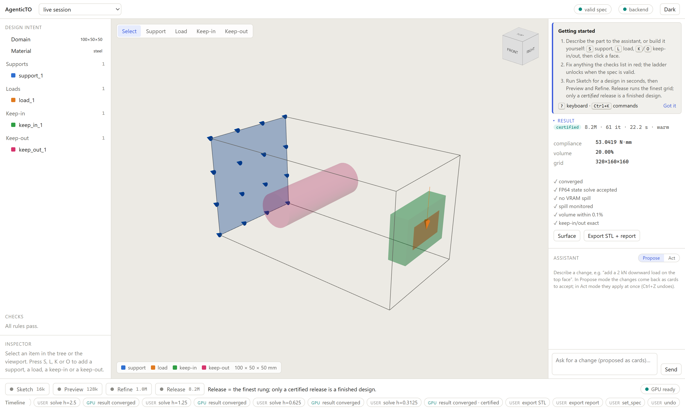

---

## 4. A tour of the workspace

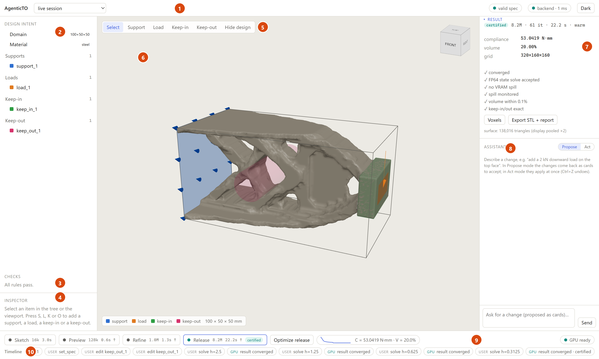

| # | Area | What it does |
|---|---|---|
| 1 | **Top bar** | Problem picker (New design, the 50 suite tasks, library problems), spec status, backend connection, light/dark theme |
| 2 | **Design intent** | Tree of the spec: domain, material, supports, loads, keep-in and keep-out. Click an item to select it; a red **error** or amber **check** badge marks items that a rule flags. |
| 3 | **Checks** | Live rule findings, each with its code, severity and plain-language message |
| 4 | **Inspector** | Exact values of the selected item, edited in place: region kind, face, centre, size, force, fixed directions |
| 5 | **Viewport tools** | Select, Support, Load, Keep-in, Keep-out; Hide design |
| 6 | **3D viewport** | The domain with supports (blue), loads (orange arrows), keep-in (green) and keep-out (pink); the density design or its surface; orientation cube; size legend |
| 7 | **Result card** | The latest finished design: certified or not, stale or current, compliance, volume, grid, each certificate check, Surface/Voxels, Export STL + report |
| 8 | **Assistant** | Chat with the design assistant; Propose/Act dial; clarification questions; proposed changes as cards |
| 9 | **Resolution ladder** | Sketch, Preview, Refine and Release buttons with their element counts, times and certificate seals; Optimize release; Stop; live compliance and volume with a convergence sparkline; GPU status |
| 10 | **Timeline** | The session log, newest on the right. Each record is tagged USER, AGENT, GPU or SYSTEM. Hover a record for its time and details. In the viewport, left-drag orbits, right-drag pans and the wheel zooms; click a face of the orientation cube to look along that axis. |

---

## 5. Building a design by hand

This tutorial builds a small cantilever bracket: a 100 × 50 × 50 mm steel block, fixed at one end, loaded at the other, with a mounting pad that must stay solid and a hole that must stay empty.

### 5.1 Start a new design

Choose **New design…** in the problem picker. You get an empty box, 100 × 50 × 50 mm, in steel, with a volume fraction of 0.3. The checks explain what is missing (Figure 3), and the ladder stays hidden until the spec is valid.

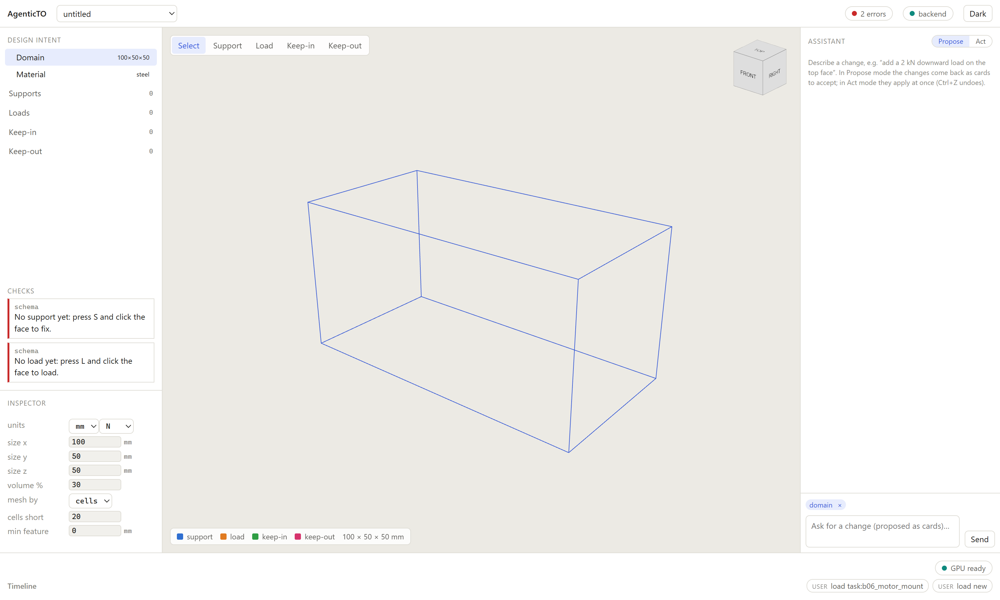

Select **Domain** in the tree to set the size, the units (mm, m or in; N, kN or lbf), the volume fraction (**volume %**), the mesh (by element size *h* or by cells along the shortest edge) and an optional minimum feature size. Select **Material** to set the name, Young's modulus *E* and Poisson's ratio *ν*.

> **Units relabel; they do not convert.** Switching from mm to m changes the label on the numbers, not the numbers. Enter every value in the units shown, and keep *E* consistent with them (N/mm² = MPa when you work in mm and N).

> **Volume fraction** is the fraction of the *design* volume: the domain minus every keep-in and keep-out region.

### 5.2 Add a support

Press <kbd>S</kbd> (or click **Support**) to arm the support tool. The toolbar shows *Click a face of the domain* (Figure 4). Click the face at x = 0. The face becomes a fixed support (all three directions), the tool returns to Select, and the new support is selected in the inspector.

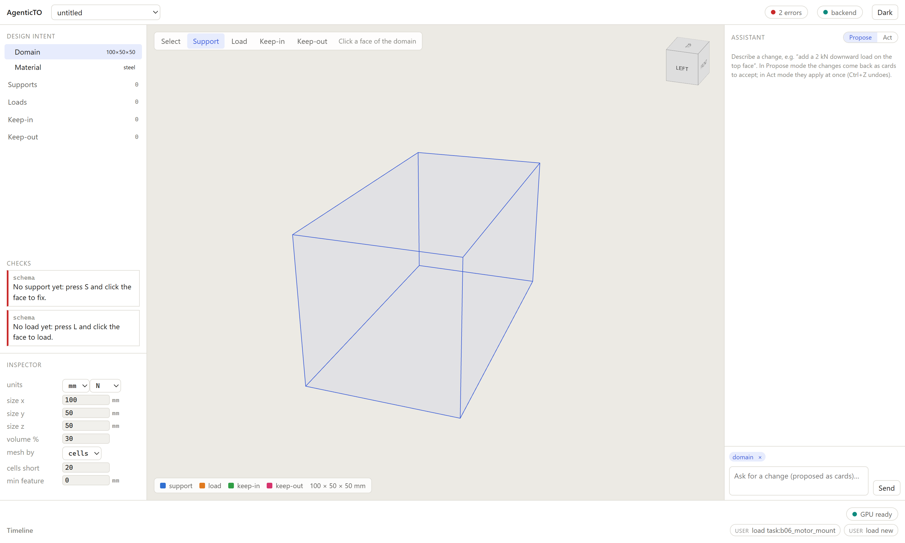

In the inspector you can change the region kind (face, patch, edge, box or cylinder) and untick the fixed directions to make a roller.

### 5.3 Add a load

Press <kbd>L</kbd> and click the face at x = 100. A 1 kN load appears on a small patch centred where you clicked, pointing into the face. Edit it in the inspector. Here the force becomes 2000 N downward (force y = −2000) and the patch 10 × 20 mm (Figure 5). Each edit takes effect as you type and is undoable.

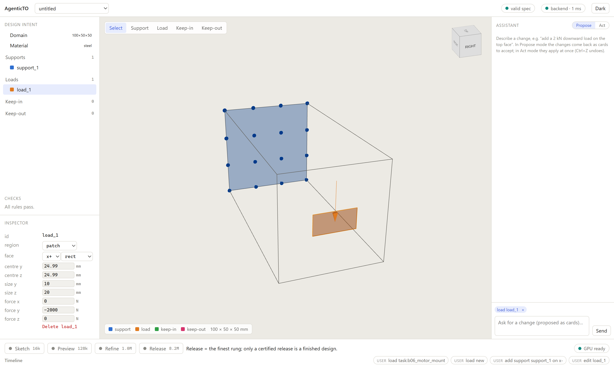

### 5.4 When a check fails

The rules run 300 ms after every edit. Figure 6 shows what happens when the support fixes only the x direction: rule **R003** reports the rigid-body motions left free (translation in y and z, rotation about x), the support gets an **error** badge in the tree, and the ladder is disabled until the problem is fixed. Tick y and z again and the error clears.

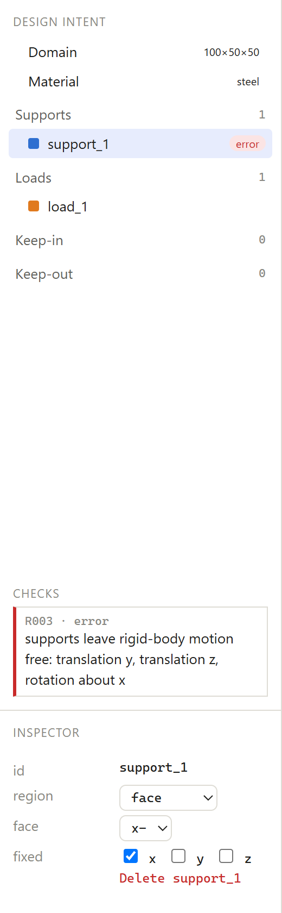

Errors block solving; warnings and notes do not. Section 11.3 lists every rule.

### 5.5 Keep-in and keep-out regions

Press <kbd>K</kbd> and click a face to add a **keep-in** region (always solid), or <kbd>O</kbd> for a **keep-out** region (always empty). Each starts as a slab 10% thick against that face. In the inspector, a keep-in or keep-out region can be a box or a cylinder, and you can switch it between keep-in and keep-out.

In Figure 7 the keep-in region was resized to a 8 × 20 × 30 mm pad under the load (min/max fields). The keep-out region was converted to a cylinder of radius 8 mm along z, centred at x = 40, which leaves a through-hole for a bolt or a cable.

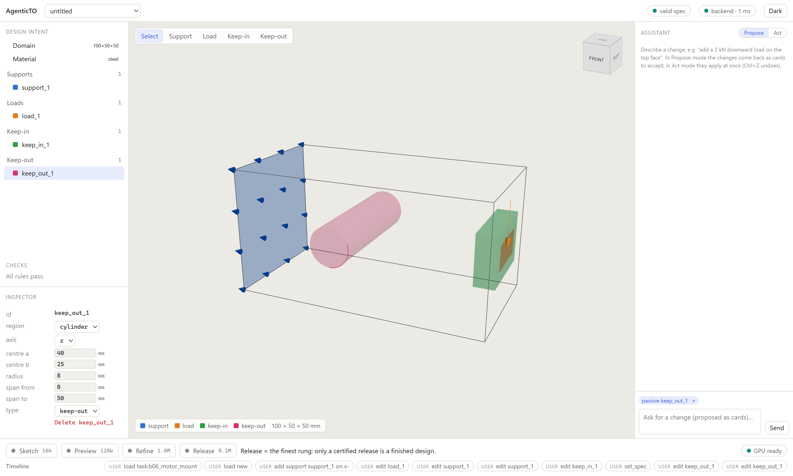

### 5.6 Undo, redo and the timeline

<kbd>Ctrl</kbd>+<kbd>Z</kbd> undoes and <kbd>Ctrl</kbd>+<kbd>Shift</kbd>+<kbd>Z</kbd> (or <kbd>Ctrl</kbd>+<kbd>Y</kbd>) redoes, across your edits and agent edits alike. Every step is a record in the timeline (Figure 15).

---

## 6. Solving: the resolution ladder and the certificate

### 6.1 The rungs

Once the spec is valid, the ladder shows four rungs. Each has twice as many elements along every edge as the rung below, so eight times as many in total:

| Rung | Purpose | Typical time (RTX 4090) |
|---|---|---|
| **Sketch** | A first design in seconds, for checking the setup | 1–3 s with a warm worker; a new spec's first sketch takes 2.5–7 s |
| **Preview** | A clearer design for judging the layout | seconds |
| **Refine** | A design close to the final one | seconds to a minute |
| **Release** | The finest grid; the only rung whose certified result is a finished design | up to a few minutes at 2.6–7.4×10^7 elements |

Click a rung to solve it. Density frames stream into the viewport while it runs. The rung shows *setting up…*, then the iteration count (Figure 8), and finally its compute time. An **↑** marks a warm start from the rung below. While a solve runs, the pill next to the ladder shows the compliance *C*, the volume *V* and a convergence sparkline; **Stop** cancels it.

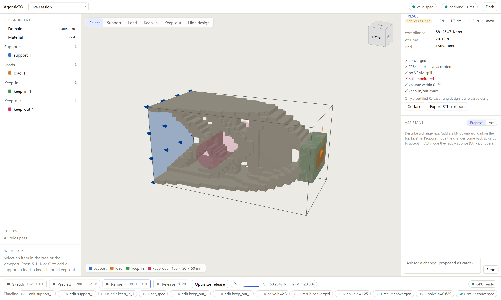

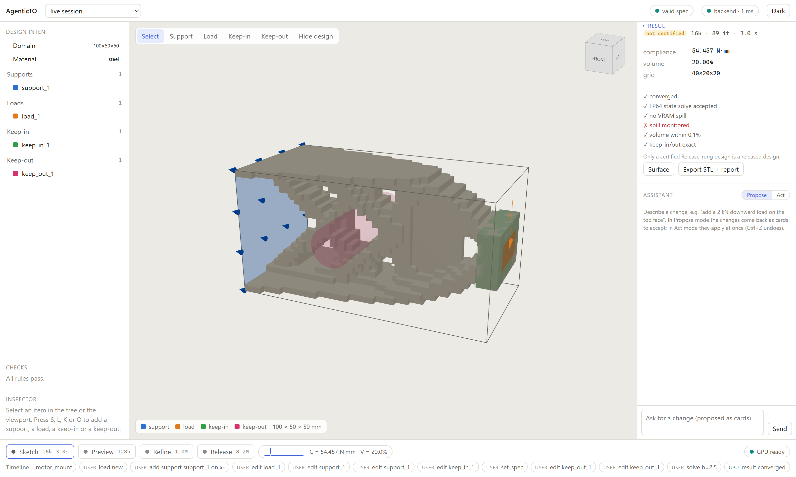

### 6.2 Release and Optimize release

Clicking **Release** warm-starts from the Refine design and certifies it on the finest grid in about 12 iterations. This mostly confirms the upsampled Refine design rather than improving it.

**Optimize release** appears once Refine has converged. It re-opens the optimization on the release grid for about 60 iterations, at roughly 50–70% of the cost of a cold solve. On the paper's five escalation problems, it ended between −3.1% and +0.07% of the cold-start compliance. Use it for the final design.

### 6.3 Reading the certificate

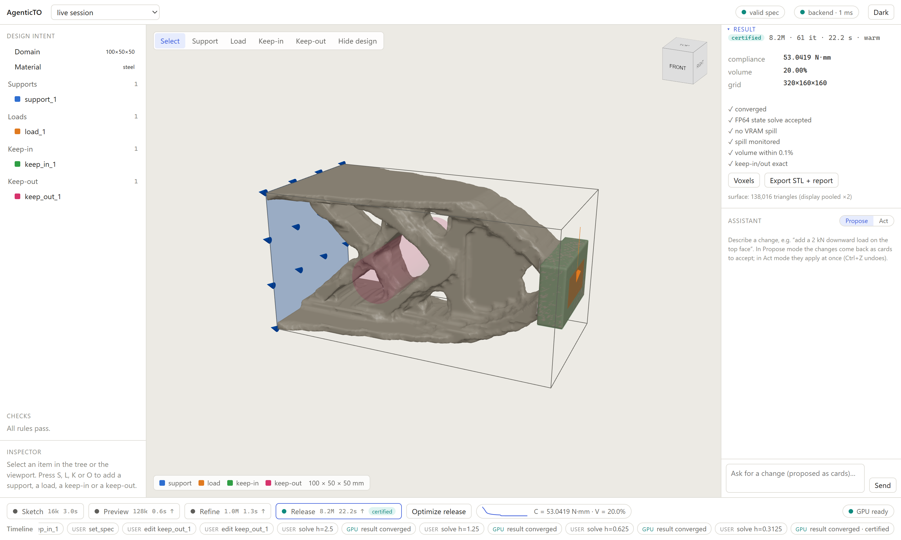

The result card (Figure 11) shows the latest finished design and its checks:

| Check | Meaning |
|---|---|
| converged | The optimizer met its stopping criterion within the iteration cap |
| FP64 state solve accepted | The final state solve was verified in double precision |
| no VRAM spill | The solve never spilled from GPU memory into shared system memory, which would make timings meaningless |
| spill monitored | The spill guard sampled GPU memory during the solve. It runs on the Release rung, so a lower rung shows ✗ here and is never certified. |
| volume within 0.1% | The design meets its volume fraction |
| keep-in/out exact | Every keep-in element is solid and every keep-out element empty |

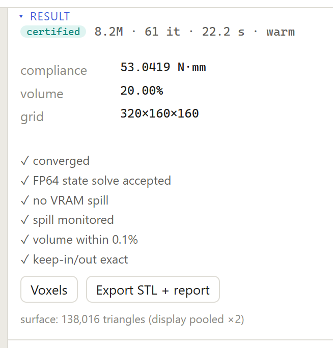

A result is **certified** only when every check passes, and only a certified result on the Release rung counts as a released design. The card says so whenever the latest result is on a lower rung.

### 6.4 Surface, voxels and export

A certified release appears as its ρ = 0.5 isosurface, extracted with marching cubes (VTK Flying Edges). For large grids the surface on screen is pooled for display, as the note under the buttons says. **Voxels** switches to the raw density field (Figure 12); **Surface** switches back.

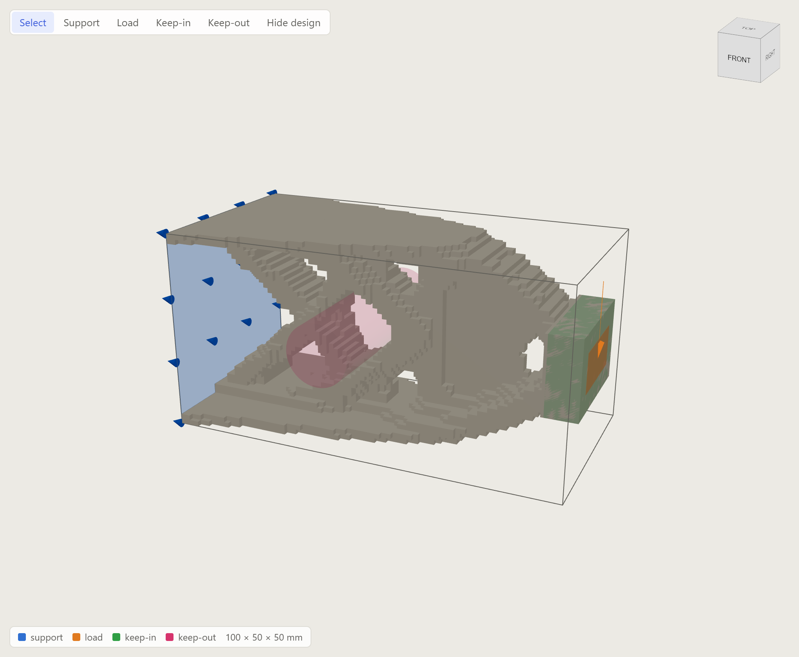

**Export STL + report** writes three files to the session's `exports/` folder, each linked from the card (Figure 13):

- a closed binary STL of the full-resolution surface (not pooled);
- a Markdown report;
- the same report in JSON, with the spec and its hash, rung and solver, iterations and time, compliance, every certificate check and the hash of the session log.

A design that is not a certified release is exported with `_draft` in its file name.

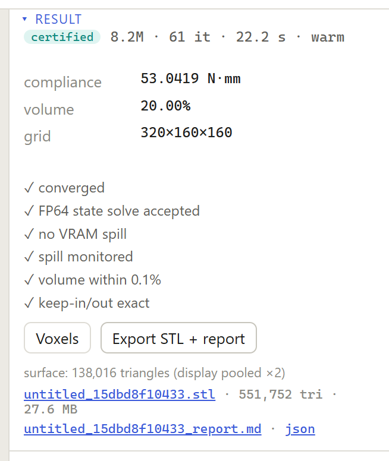

### 6.5 Stale results

Change the spec after a solve and the card marks its result **stale** (Figure 14): the design on screen no longer matches the spec. Undo the change and the badge clears, because each result is tied to the hash of the spec it solved.

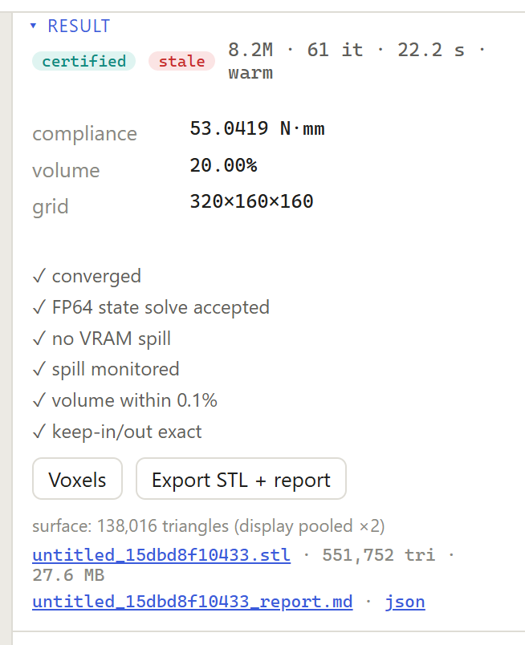


---

## 7. Working with the assistant

The assistant panel connects to a Codex session through your ChatGPT subscription. Describe a part or a change in words. You can paste a whole design brief. The assistant works only through the same tools the workspace uses: it builds and edits the spec, queries what each region covers, validates, and asks you when the brief is ambiguous.

### 7.1 Propose and Act

The dial in the panel header sets the autonomy:

| Mode | What the assistant may do | How you see it |
|---|---|---|
| **Propose** (default) | Works on a private copy of your spec. It can edit, ground and validate, and it can ask questions. It cannot solve. | When it finishes, every difference from your spec becomes a **card**. Nothing changes until you accept. |
| **Act** | Edits the live spec directly, and may run Sketch and Preview solves to check its work. Releasing stays your decision. | Edits appear immediately in the tree, the viewport and the timeline (tagged AGENT). **Undo this run's edits** reverts the whole run. |

### 7.2 Clarification questions with consequence previews

When a brief leaves something open that changes the design (which face, how large a pad, which direction), the assistant asks instead of guessing. Each possible reading appears as a chip with a thumbnail of the design it leads to, solved on the Sketch rung, and that design's compliance (Figures 16 and 17). Pick a chip, or type your own answer under **None of these**.


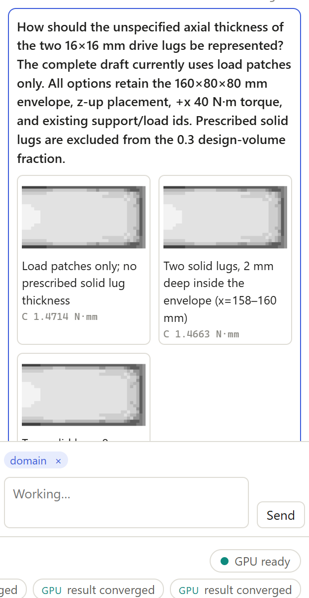

On the paper's 50-brief suite, clarification removed every silent wrong specification made by the Codex assistant: 0 of 50, against 6 of 50 without it.

> **If a question waits for minutes.** Take your time. The assistant is told to wait for your answer. If its session has ended by the time you answer, your answer starts a follow-up run that applies it.

### 7.3 Cards and the ghost overlay

In Propose mode the result is a set of cards, one per change: *add*, *change*, *remove* or *set*. Hover a card to see its ghost in the viewport (Figure 18). **Accept** or **Reject** each card, or use **Accept all** and **Reject all**. Accepted cards are applied as one undoable step, logged as yours.

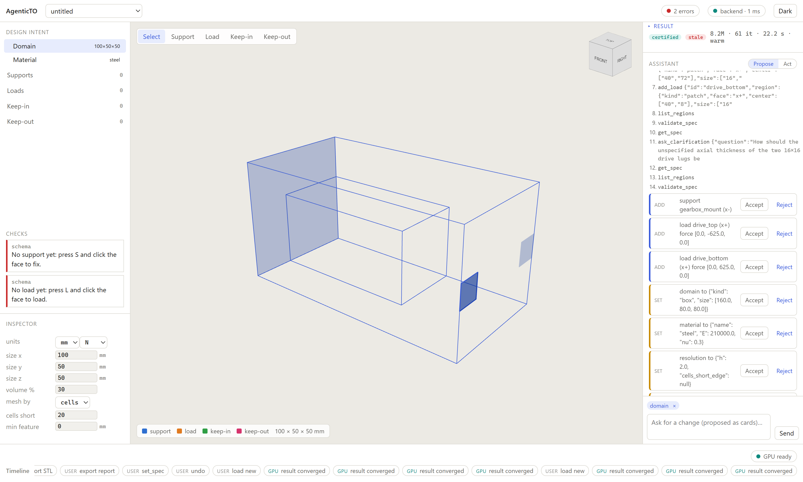

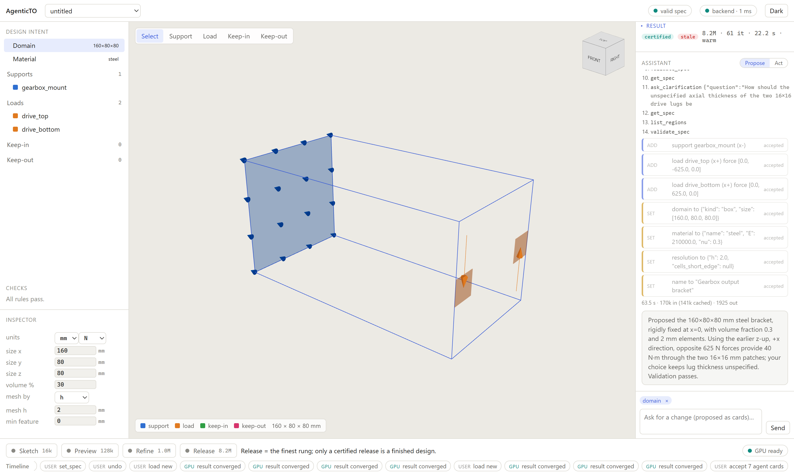

### 7.4 An Act run

In Figure 20 the assistant in Act mode lowers the volume fraction and runs a sketch to check the design. The steps drawer lists every tool call. A failed call shows its error, which the assistant then fixes. The footer gives the wall time and the token use. **Undo this run's edits** reverts the run as a whole.

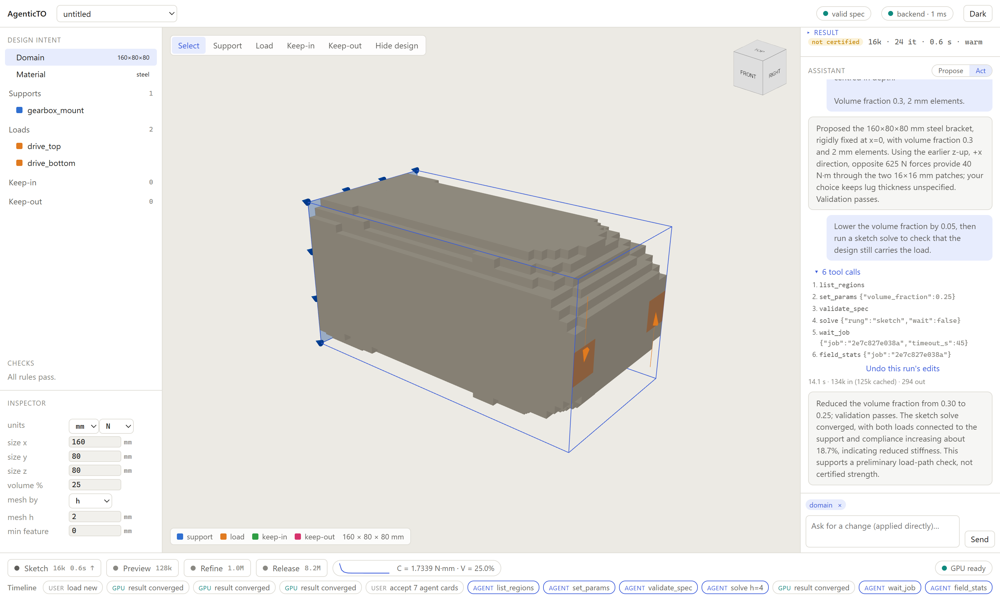

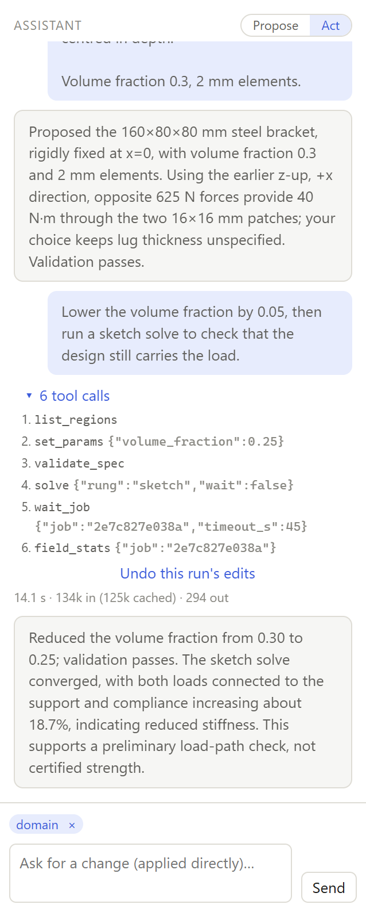

---

## 8. Connecting other agents (MCP)

The tools behind the workspace are exposed as an MCP server, `agentto.mcp_server`. Any MCP client can use them. The paper's benchmarks ran Codex and Claude Code through this server.

### 8.1 Attach to the live workspace

With the backend running, an external agent can attach to the session you have open. Its edits and solves appear in the workspace as they happen, tagged AGENT, and are undoable like any other step.

**Claude Code.** Save this as `mcp.json` (adjust the paths):

```json
{"mcpServers": {"agentto": {
  "command": "python",
  "args": ["-B", "-m", "agentto.mcp_server", "--profile", "full", "--attach", "http://127.0.0.1:8765"],
  "env": {"PYTHONPATH": "C:/path/to/AgenticTO/src"}}}}
```

```bash
claude --mcp-config mcp.json
```

**Codex CLI.** Add this to `~/.codex/config.toml`:

```toml
[mcp_servers.agentto]
command = "python"
args = ["-B", "-m", "agentto.mcp_server", "--profile", "full", "--attach", "http://127.0.0.1:8765"]
env = { PYTHONPATH = "C:/path/to/AgenticTO/src" }
startup_timeout_sec = 60
tool_timeout_sec = 900
default_tools_approval_mode = "approve"
```

Without `default_tools_approval_mode = "approve"`, non-interactive Codex runs (`codex exec`) reject every MCP call.

In Figure 22, Claude Code (claude-opus-5-5, through a claude.ai subscription) was asked to add a 300 N load on the top face of the part from section 7 and validate the spec. It took 13 s. Its calls appear in the timeline as AGENT records, and the new load appears in the tree and the viewport.

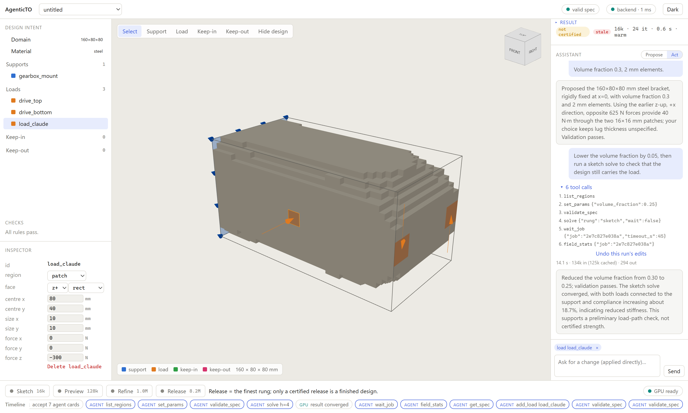


### 8.2 Stand-alone sessions

Without the workspace, the server keeps its own session in a folder, with its own GPU worker:

```bash
python -B -m agentto.mcp_server --session runs/my_session --profile full
python -B -m agentto.mcp_server --session runs/b01 --profile clarify --seed spec.json
python -B -m agentto.mcp_server --session runs/b01 --profile clarify --answer-url http://127.0.0.1:8765
```

`--seed` starts the session from an existing spec. `--answer-url` sends the agent's clarification questions to the user of a running workspace.

### 8.3 Profiles

| Profile | Tools | Used for |
|---|---|---|
| `spec` | spec editing, grounding (`list_regions`, `render`), `validate_spec`, `explain_spec`, undo/redo | Building a spec only (the paper's G condition) |
| `clarify` | `spec` plus `ask_clarification` | The Propose assistant; the G+C condition |
| `full` | everything, including templates, solving, `field_stats` and export | Act mode, end-to-end sessions (X3), attaching to the workspace |

---

## 9. Scripting, logs and replay

### 9.1 The tool contract from Python

```python
import sys; sys.path.insert(0, "src")
from agentto.tools import Session

if __name__ == "__main__":                     # the GPU worker is a spawned process
    s = Session("runs/demo", profile="full")
    s.call("new_spec", {"name": "bracket", "size": [100, 50, 50]})
    s.call("set_params", {"volume_fraction": 0.3, "cells_short_edge": 20})   # a solve needs both
    s.call("add_support", {"id": "wall", "region": {"kind": "face", "face": "x-"}})
    s.call("add_load", {"id": "tip", "force": [0, -2000, 0],
                        "region": {"kind": "patch", "face": "x+", "center": [25, 25], "size": [10, 20]}})
    print(s.call("validate_spec"))
    print(s.call("solve", {"rung": "sketch"}))
    s.runner.close()                            # stop the GPU worker
```

Each `call` is checked, applied and logged exactly as a workspace edit or an agent call would be.

### 9.2 Session folders

The backend writes each workspace session to `sessions/<yyyymmdd-hhmmss>/`:

| Path | Contents |
|---|---|
| `session.jsonl` | Every call (tool, arguments, actor, spec hash, ok/error), every result and every clarification answer |
| `fields/` | Saved density fields (float16) |
| `exports/` | STL files and reports |
| `renders/` | Setup renders returned by `render` |
| `agent/` | One folder per assistant run, with the agent's event stream and stderr |

### 9.3 Replay without an LLM

```python
from agentto.tools import replay
print(replay("sessions/20261031-101500/session.jsonl", root="runs/replayed"))
```

Replay re-runs every call. It checks each call's outcome and spec hash, reuses recorded clarification answers, and re-solves every solve, which must reproduce its status, iteration count, compliance (bit for bit) and certificate.

### 9.4 Reproducing the paper

| Study | Script | Output |
|---|---|---|
| X0 verification | `scripts/x0_identity_gpu.py`, `x0_replay.py`, `x0_crosscheck_skfem.py` | `results/X0/` |
| X1 escalation arms | `scripts/x1_escalation.py` | `results/X1/` |
| X2 spec grounding, 50 briefs | `scripts/x2_run.py --provider codex\|claude`, `x2_score.py`, `x2_rules_baseline.py` | `results/X2/` |
| X3 brief to certified release | `scripts/x3_run.py <task> [--provider claude]` | `results/X3/` |
| X5 resolution | `scripts/x5_resolution.py`, `x5_chain.py` | `results/X5/` |
| X6 GUI latency, KLM, cards | `scripts/x6a_latency.py`, `x6b_klm.py`, `x6c_cards.py` | `results/X6/` |
| C4 gate ablation | `scripts/c4_gate_ablation.py` | `results/C4/` |
| GUI end-to-end test (90 checks) | `scripts/gui_test.py setup ladder overlays assistant` | `results/gui_test/` |
| Claims, tables, figures | `scripts/make_ledger.py`, `make_tables.py`, `make_figures.py` | `results/claims_ledger.md`, `paper/tables/`, `results/figures/` |

---

## 10. Keyboard and command palette

Press <kbd>?</kbd> for the keyboard map (Figure 24) and <kbd>Ctrl</kbd>+<kbd>K</kbd> for the command palette (Figure 25). In the palette, type to filter, use the arrow keys to move, and press <kbd>Enter</kbd> to run a command. Shortcuts are off while you type in a field.

| Key | Action |
|---|---|
| <kbd>V</kbd> | Select tool |
| <kbd>S</kbd> / <kbd>L</kbd> | Support / load tool: click a face |
| <kbd>K</kbd> / <kbd>O</kbd> | Keep-in / keep-out tool: click a face |
| <kbd>Esc</kbd> | Cancel the tool, close a dialog |
| <kbd>Ctrl</kbd>+<kbd>Z</kbd> | Undo |
| <kbd>Ctrl</kbd>+<kbd>Shift</kbd>+<kbd>Z</kbd>, <kbd>Ctrl</kbd>+<kbd>Y</kbd> | Redo |
| <kbd>Ctrl</kbd>+<kbd>K</kbd> | Command palette |
| <kbd>?</kbd> | Keyboard map |
| <kbd>Enter</kbd> / <kbd>Shift</kbd>+<kbd>Enter</kbd> | In the assistant: send / new line |

<div class="pair" markdown="1">

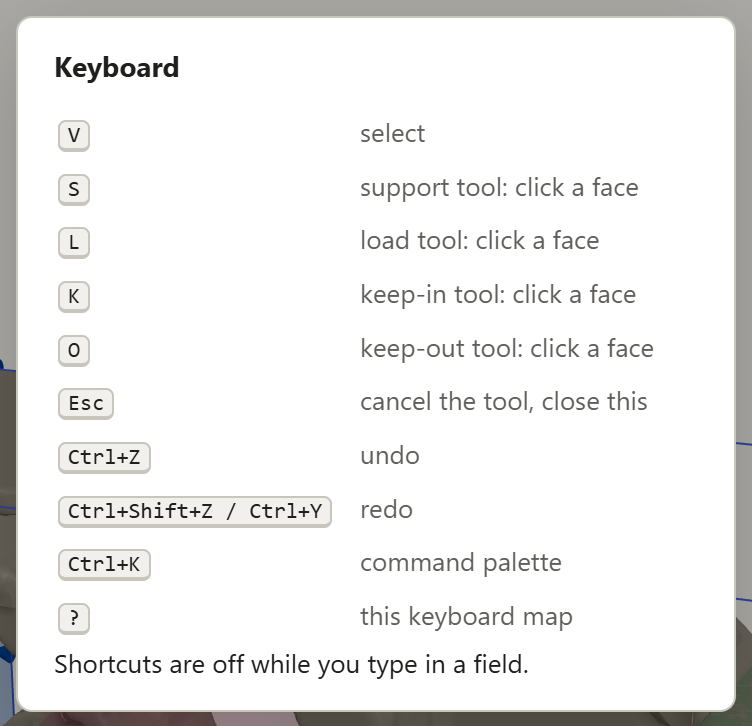

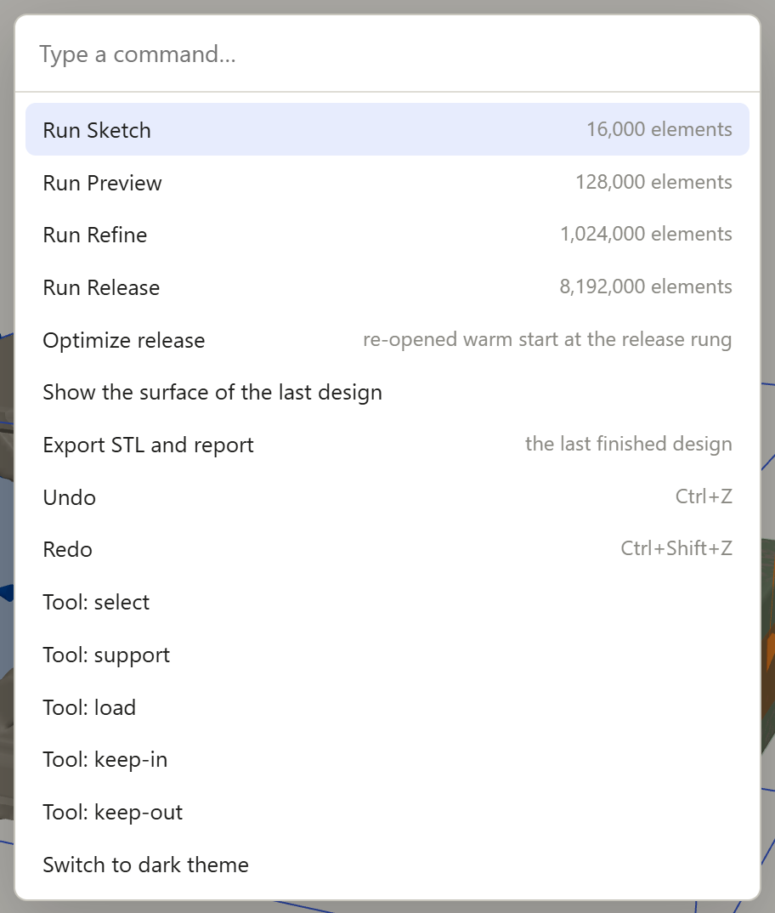

</div>

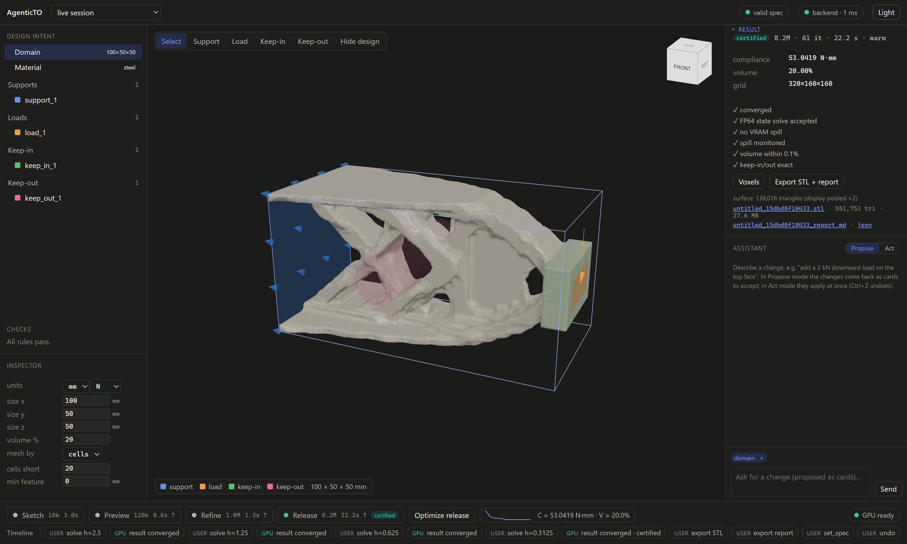

---

## 11. Reference

### 11.1 The spec

A spec is a JSON document. Coordinates are absolute, with the origin at the domain's minimum corner. This is the intended spec of suite task b01:

```json
{
  "schema_version": "agentto.spec/v0",
  "name": "b01 cantilever block",
  "units": {"length": "mm", "force": "N"},
  "domain": {"size": [200, 100, 100]},
  "material": {"name": "steel", "E": 210000.0, "nu": 0.3},
  "volume_fraction": 0.3,
  "supports": [{"id": "wall", "region": {"kind": "face", "face": "x-"}}],
  "loads": [{"id": "pad", "force": [0, -1000, 0],
             "region": {"kind": "patch", "face": "x+", "center": [50, 50], "size": [10, 10], "shape": "rect"}}],
  "passive": [],
  "resolution": {"h": 1.0}
}
```

The full JSON Schema is `schemas/spec_v0.schema.json`. A support fixes all three directions unless `fix` lists fewer (for example `["x", "y"]` for a roller free in z). All loads act together as one load case. Keep-in and keep-out regions are `passive` items with `kind` `solid` or `void`. Set the resolution by element size `h` or by `cells_short_edge`; `min_feature` is optional.

### 11.2 Regions

| Kind | Fields | Valid for |
|---|---|---|
| `face` | `face`: one of x−, x+, y−, y+, z−, z+ | supports, loads |
| `patch` | `face`, `center` and `size` in the face's two in-plane axes, `shape` rect or ellipse | supports, loads |
| `edge` | `axis`, `at` (the other two coordinates), optional `span` | supports, loads |
| `box` | `min`, `max` | supports, loads, keep-in/out |
| `cylinder` | `axis`, `center` (two coordinates), `radius`, `span` | supports, loads, keep-in/out |

A region is snapped to the grid's nodes or elements. When the snapping changes it noticeably, rule R010 says so.

### 11.3 Rules

| Code | Severity | Fires when |
|---|---|---|
| R001 | error | No grid fits: a domain side is not a whole number of elements of size *h*. A cell count that fits is suggested. |
| R002 | error | A support selects no nodes |
| R003 | error | The supports leave rigid-body motion free (names the free translations and rotations) |
| R004 | error | A load selects no nodes, or every load is zero |
| R005 | error / warning | Part of the load acts on fixed nodes and would be lost (error above 50%) |
| R006 | error | No design elements remain after the keep-in and keep-out regions |
| R007 | error | Elements are both keep-in and keep-out |
| R008 | error | A support or load lies entirely inside a keep-out region |
| R009 | warning | The minimum feature is too small to resolve at this element size (suggests an *h*) |
| R010 | warning | A region was snapped to the grid in a way that changes it |
| R011 | warning | A keep-in or keep-out region contains no element centre at this resolution |
| R012 | warning / info | On the coarsest multigrid level the supports leave modes free (the solver switches to a robust coarse rule) or lose some nodes |
| R013 | error | The grid needs more GPU memory than is available (suggests a coarser rung) |

### 11.4 Tools

| Group | Tools |
|---|---|
| Build | `new_spec`, `set_spec`, `load_template`, `set_params`, `add_support`, `add_load`, `add_passive`, `update_item`, `remove_item`, `undo`, `redo` |
| Inspect and check | `get_spec`, `list_regions`, `validate_spec`, `explain_spec`, `render`, `ladder` |
| Ask | `ask_clarification` (options, optional consequence previews) |
| Solve | `solve` (rung or *h*, warm start, `optimize`), `status`, `wait_job`, `cancel`, `field_stats` |
| Export | `export_stl`, `export_report` |

Every tool returns compact JSON. `render` returns a picture of the supports and loads for confirming a setup. Tool descriptions, with argument types, are served by the MCP server (`tools/list`).

---

## 12. Troubleshooting and limits

### 12.1 Troubleshooting

| Symptom | Cause and fix |
|---|---|
| The **GPU** pill stays *starting* or turns *dead* | The worker could not load CuPy or `voxfem`. Check that `src/` is on the path (or `VOXFEM_SRC`, if set) and the CUDA 12 install, then look at the backend console. |
| The ladder is missing or greyed out | The spec has an error. Fix what **Checks** lists in red. |
| A release stops with a spill message | Another program is holding GPU memory and the solve would spill into shared memory. Close GPU-heavy applications (browsers with hardware acceleration, games, other CUDA jobs) or release a coarser rung. Run one GPU job at a time. |
| The first sketch of a new spec takes several seconds | Expected: the first solve of a spec builds its multigrid hierarchy (2.5–7 s); repeated sketches take 1–3 s. |
| A release is *not certified* | Read the ✗ on the card: a solve that did not converge, a volume miss or a spill. Optimize release, or adjust the spec. |
| The assistant refuses to start: *PolicyError* | An API key variable is set, or Codex is not on a ChatGPT login. Unset the variable or run `codex login`. |
| The assistant answers but changes nothing | In Propose mode, changes come back as cards; accept them. In Act mode, check the steps drawer for failed calls. |
| An external agent's calls are all rejected | For Codex, set `default_tools_approval_mode = "approve"`; for Claude Code, allow the `mcp__agentto` tools. |

### 12.2 Limits of this version

- Linear elastic compliance minimization under one volume constraint; one load case (all loads act together).
- Box design domains on a regular voxel grid; no import of existing geometry (STL or STEP).
- Releases are bounded by GPU memory: 2.6–7.4×10^7 elements on a 24 GB card in the paper. A 1.1×10^8-element run did not fit beside a normal desktop's GPU memory use.
- The built-in assistant uses Codex; other agents connect through MCP. How much clarification helps depends on whether the model asks. In the paper, Claude Code asked 7 questions on 50 briefs where Codex asked 59, and kept 4 silent errors where Codex made none.
- The workspace has been tested in Chrome on Windows with one user per session.

---

*AgenticTO is research software released with the paper. Report problems through the repository's issue tracker.*
